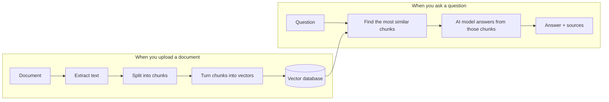

# DocChat

**Ask questions about your documents and get answers with sources.**

Upload a PDF, Word, Markdown or text file, then ask a question in plain language. DocChat finds the parts of your documents that matter and answers using only those parts. Every answer tells you where it came from, for example `[handbook.docx section 3]` or `[report.pdf p.12]`, so you can check it yourself.

If the answer isn't in your documents, DocChat says **"I don't know"** instead of guessing.

Everything runs on your own computer: your documents are never sent to an outside service.

---

## How it works

DocChat uses a technique called **RAG** (Retrieval-Augmented Generation): first *retrieve* the relevant text, then let an AI model *generate* an answer from it.



1. **Upload:** the text is extracted, split into small overlapping pieces (chunks), and each chunk is turned into a list of numbers (a vector) that captures its meaning. These are stored in a vector database.
2. **Ask:** your question is turned into a vector the same way, and the chunks with the closest meaning are found.
3. **Answer:** those chunks and your question are given to a local AI model, with instructions to answer only from them and cite the source.

## Features

- Supports **PDF, Word (.docx), Markdown (.md) and plain text (.txt)**
- Answers cite the file and page (PDF) or section (other formats)
- Refuses to answer when the documents don't contain the answer
- Runs fully offline with a local AI model ([Ollama](https://ollama.com))
- Upload safety checks: file type, real file content, size limit, protection against "zip bomb" files
- Measured quality: an evaluation script scores the answers (see [Results](#results))

## Tech stack

| Part | Tools |
|---|---|
| Backend API | Python, FastAPI |
| Document reading | pypdf, python-docx |
| Embeddings (text → vectors) | sentence-transformers (`all-MiniLM-L6-v2`) |
| Vector database | ChromaDB |
| AI model | Ollama with `llama3.2` |
| Frontend | React, TypeScript, Vite |
| Testing and code quality | pytest, ruff, oxlint |

---

## Getting started

### What you need

- [Python 3.13+](https://www.python.org/downloads/) and [uv](https://docs.astral.sh/uv/)
- [Node.js 24+](https://nodejs.org)
- [Ollama](https://ollama.com/download)
- About 4 GB of free disk space (AI model + libraries)

> **Windows:** PyTorch needs an up-to-date [Microsoft Visual C++ Redistributable](https://learn.microsoft.com/cpp/windows/latest-supported-vc-redist). If the backend fails with `WinError 126`, install the latest version.

### 1. Download the AI model

```bash
ollama pull llama3.2
```

### 2. Start the backend

```bash
cd backend
uv sync
uv run uvicorn app.main:app --reload
```

The API runs at <http://localhost:8000>. Interactive API docs are at <http://localhost:8000/docs>.

### 3. Start the frontend

In a second terminal:

```bash
cd frontend
npm install
npm run dev
```

Open **<http://localhost:5173>**, upload a document, and start asking questions.

> The first answer can take a minute or two, because the models are loading. Later answers are faster. Speed depends on your computer, since the AI model runs on your own processor.

### Settings (optional)

All settings have sensible defaults. To change one, create a file `backend/.env`:

| Setting | Default | What it does |
|---|---|---|
| `OLLAMA_MODEL` | `llama3.2` | Which Ollama model answers questions |
| `OLLAMA_URL` | `http://localhost:11434` | Where Ollama is running |
| `PROMPT_VERSION` | `v2` | Which answer instructions to use (`v1` or `v2`) |
| `CHUNK_SIZE` / `CHUNK_OVERLAP` | `800` / `150` | Chunk length and overlap, in characters |
| `MAX_UPLOAD_MB` | `20` | Largest file you can upload |

For example:

```env
OLLAMA_MODEL=llama3.2
MAX_UPLOAD_MB=50
```

### Docker

> 🚧 **Not tested yet.** The Docker setup is written but hasn't been built and verified.

```bash
docker compose up --build
```

This is meant to start both parts at <http://localhost:5173>, with Ollama still running on your computer.

---

## API

| Method | Endpoint | What it does |
|---|---|---|
| `GET` | `/health` | Checks that the server is running |
| `POST` | `/documents` | Uploads a document |
| `GET` | `/documents` | Lists uploaded documents |
| `POST` | `/search` | Finds the most relevant chunks (no AI answer) |
| `POST` | `/chat` | Asks a question and returns an answer with sources |

Example request to `/chat`:

```json
{ "question": "Which planet has the tallest volcano?", "top_k": 3 }
```

Example response (shortened):

```json
{
  "answer": "Mars is home to Olympus Mons, the tallest volcano in the solar system. [solar_system.pdf p.1]",
  "sources": [{ "filename": "solar_system.pdf", "page": 1, "location": "p.1", "snippet": "The Sun and the Inner Planets..." }]
}
```

---

## Results

Answer quality is measured with a set of 24 test questions about a sample document (`backend/evals/`). 14 questions can be answered from the document, and 10 can't, so the right response to those is "I don't know".

Comparison of the original answer instructions (v1) with the improved version (v2), with all other settings unchanged:

| Metric | v1 | v2 (current) |
|---|---|---|
| Says "I don't know" when it should | 80% | **100%** |
| Wrongly says "I don't know" | 0% | 7% (1 question) |
| Answer correctness (1–5, graded by the AI model) | 4.7 | 4.7 |
| Cites the correct page | 100% | 100% |

**What changed:** v1 sometimes answered from the AI model's own memory when the document only had a *similar* fact. For example, asked about Saturn's largest moon, it named a wrong moon instead of saying the document doesn't cover it. v2 adds an example of exactly that trap, which fixed those cases. The cost: it now refuses one question it could answer.

**Keep in mind:** this is a small test on one short document. It shows the direction of each change, not a guarantee for your own documents.

Run the evaluation yourself (Ollama must be running):

```bash
cd backend
uv run python -m evals.run_evals --label my-run
```

## Running the tests

```bash
cd backend
uv run pytest
```

```bash
cd frontend
npm run lint
npm run build
```

---

## Limitations

- **Scanned documents** (images of pages) and old **.doc** Word files aren't supported.
- **Images, charts and diagrams** inside documents are ignored; only text is used.
- **No conversation memory:** each question is answered on its own, so follow-ups like "tell me more" don't work.
- **Not suited for summaries:** only the most relevant chunks are used, not the whole document.
- **Mistakes are still possible:** the small local AI model can mix up similar facts. Check the cited source for anything important.
- **One user, one computer:** there are no accounts. Everyone using the app sees all uploaded documents.

## Project structure

```text
backend/
  app/
    api/routes/      API endpoints (documents, search, chat, health)
    services/        Document loading, chunking, embeddings, vector store, RAG
    prompts/         Instructions given to the AI model (v1, v2)
  evals/             Test questions, evaluation script and saved results
  tests/             Automated tests
frontend/
  src/
    api/             Calls to the backend
    components/      Upload, chat and message components
docker-compose.yml   Runs everything with Docker (not tested yet)
```

## What I learned

This is a learning project. Building it covered:

- **RAG:** chunking, embeddings, vector search and grounded answers with citations
- **LLMs and prompt engineering:** writing instructions and improving them with measured experiments
- **Evaluation:** turning "it seems fine" into numbers (hit rate, MRR, refusal accuracy, LLM-as-judge)
- **APIs:** a tested FastAPI backend consumed by a React frontend
- **Security basics:** validating uploads, guarding against prompt injection, keeping secrets out of Git
- **Version control:** small branches, pull requests and conventional commit messages
