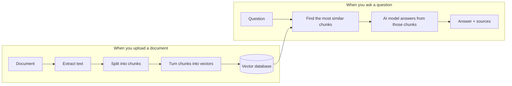

# DocChat

**Ask questions about your documents and get answers with sources.**

## Purpose

Finding a specific fact in long documents takes time. DocChat lets you upload your documents and simply ask about them in plain language. It answers using only what your documents say, and shows exactly where each answer comes from, so it doesn't make assumptions.

## What it does

- Accepts **PDF, Word (.docx), Markdown (.md) and plain text (.txt)** files
- Answers questions in plain language, based only on the uploaded documents
- Cites the source of every answer, for example `[report.pdf p.12]` or `[handbook.docx section 3]`
- Doesn't make assumptions if you ask something that is not contained in the file you have uploaded
- Runs entirely on your own computer, so documents never leave it

## Features

- Supports **PDF, Word (.docx), Markdown (.md) and plain text (.txt)**
- Answers cite the file and page (PDF) or section (other formats)
- Refuses to answer when the documents don't contain the answer
- Runs fully offline with a local AI model ([Ollama](https://ollama.com))
- Upload safety checks: file type, real file content, size limit, protection against "zip bomb" files
- Measured quality: an evaluation script scores the answers

## How it works

DocChat uses **RAG** (Retrieval-Augmented Generation): it first *retrieves* the relevant parts of your documents, then an AI model *generates* an answer from them.

1. **Upload:** the text is extracted from the document and split into small, overlapping pieces (chunks). Each chunk is turned into a list of numbers (a vector) that represents its meaning, and stored in a vector database.
2. **Ask:** the question is turned into a vector the same way, and the chunks closest in meaning are found.
3. **Answer:** those chunks and the question are given to a local AI model, which answers using only them and cites where each fact came from.

## Tech stack

| Part | Tools |
|---|---|
| Backend API | Python, FastAPI |
| Document reading | pypdf, python-docx |
| Embeddings (text → vectors) | sentence-transformers (`all-MiniLM-L6-v2`) |
| Vector database | ChromaDB |
| AI model | Ollama with `llama3.2` |
| Frontend | React, TypeScript, Vite |
| Testing | pytest |
